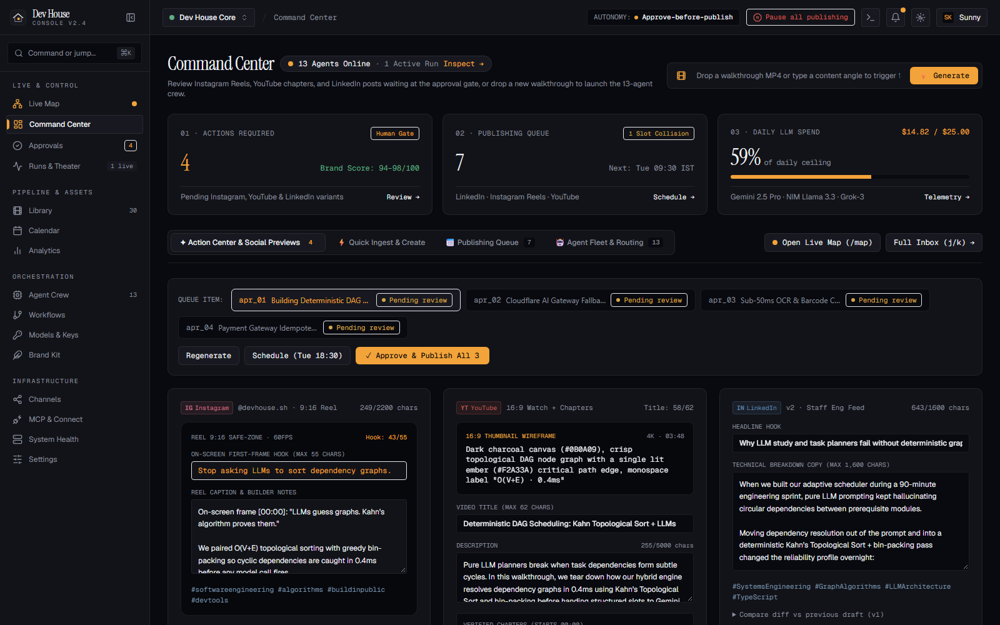
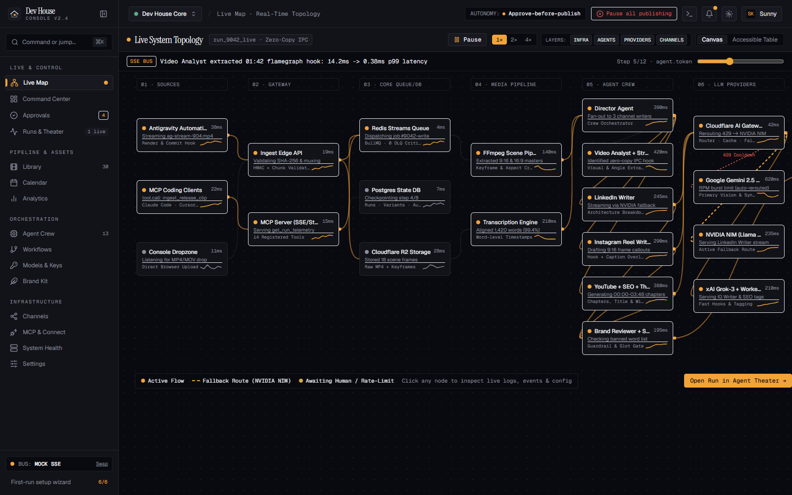
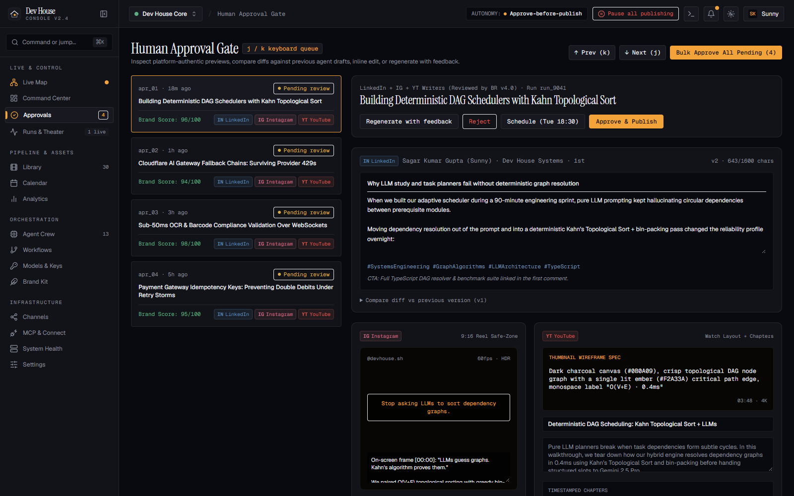
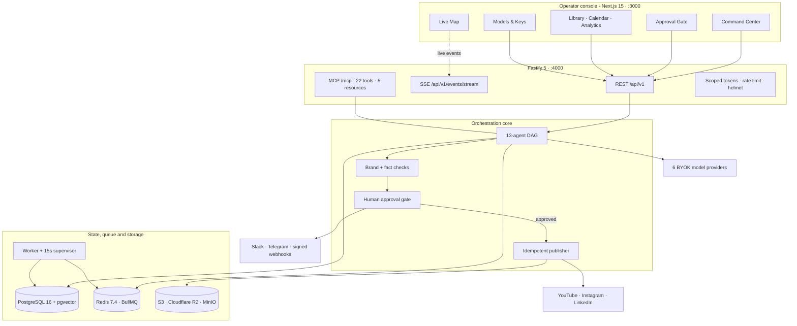
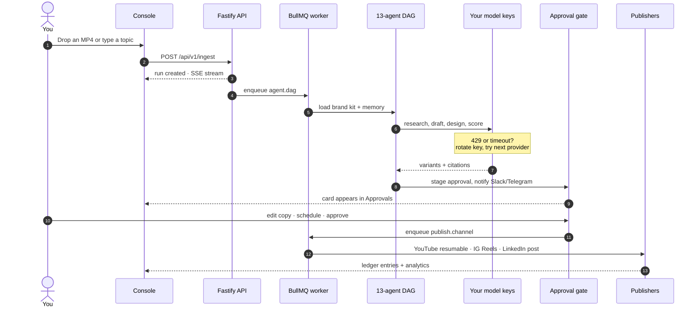

<p align="center">
  
</p>

<h1 align="center">Dev House</h1>

<p align="center">
  <strong>A self-hosted AI content studio with a human in the loop.</strong><br/>
  Drop in a video or a topic. Get platform-ready Reels, YouTube videos and LinkedIn posts.<br/>
  Nothing goes live until you click <em>Approve</em>.
</p>

<p align="center">
  
  
  
  
  
  
  
  
</p>

<p align="center">
  <a href="#run-it-locally"><strong>Quick start</strong></a> ·
  <a href="#see-it-in-action"><strong>Screenshots</strong></a> ·
  <a href="#how-it-works"><strong>How it works</strong></a> ·
  <a href="#your-first-ten-minutes"><strong>First run</strong></a> ·
  <a href="#configuration"><strong>Configuration</strong></a>
</p>

---

## Contents

- [What is Dev House?](#what-is-dev-house)
- [See it in action](#see-it-in-action)
- [How it works](#how-it-works)
- [Run it locally](#run-it-locally)
- [Your first ten minutes](#your-first-ten-minutes)
- [Screen guide](#screen-guide)
- [Connect real accounts](#connect-real-accounts)
- [Configuration](#configuration)
- [Who it is for](#who-it-is-for)
- [Repository layout](#repository-layout)
- [Quality gates](#quality-gates)
- [Troubleshooting](#troubleshooting)
- [Security notes](#security-notes)
- [Learn more](#learn-more)

---

## What is Dev House?

Dev House is a content studio that runs itself — with you as editor-in-chief.

You give it **a video file** (a walkthrough, a demo, a podcast clip) **or just a topic**. Thirteen specialised AI agents then:

1. **Watch and listen** to the media (ffprobe/ffmpeg for scenes, keyframes, aspect ratios; transcription for the spoken words).
2. **Research the angle** — what is actually interesting, what people are already saying, which hook earns the first three seconds.
3. **Write three different posts** — an Instagram Reel caption, a YouTube title/description/chapters, and a LinkedIn technical post. Each respects that platform's character limits and tone.
4. **Design the visuals** — a 9:16 safe-zone cover for Reels, a 16:9 thumbnail wireframe with chapters for YouTube.
5. **Score and fact-check** — brand voice compliance plus citations for every claim, with a visible score like `96 / 100`.
6. **Stop at a human gate.** Everything is staged in the Approval queue with platform previews and a change history.
7. **Publish only after you approve** — resumable YouTube upload, Instagram Reels container flow, LinkedIn REST posts — then track the ledger and analytics.

> **Think of it as a small newsroom.** Scouts, researchers, writers, designers, fact-checkers and a publisher all work in parallel. You sit at the editor's desk and decide what ships.

**Why people use it:** the boring 80% of content production (research, reformatting one idea into three platforms, thumbnails, scheduling) disappears, while editorial control stays with a person.

**It is fully self-hosted.** Your footage, keys and drafts stay on your machine or your own infrastructure. No Dev House account, no per-seat subscription.

---

## See it in action

### Your one job: approve

<p align="center">
  
</p>

<p align="center"><em>Every run ends here. Review the copy, compare against the previous draft, edit inline, or send it back with a note — then approve.</em></p>

### The Command Center

<p align="center">
  
</p>

<p align="center"><em>One screen answers: what needs me, what is queued, what am I spending, and are the agents healthy?</em></p>

### The Live Map

<p align="center">
  
</p>

<p align="center"><em>Watch each run move through sources → gateway → queue → media → agents → providers. Click a node for logs, events and config.</em></p>

### The Approval Gate

<p align="center">
  
</p>

<p align="center"><em>Queue on the left, full preview on the right. Regenerate with feedback, reject, schedule, or approve and publish.</em></p>

---

## How it works

<p align="center">
  
</p>

### System architecture



**Reading the diagram:** the console only talks to the Fastify API. The API hands work to the agent DAG, which calls your own model keys, writes state to PostgreSQL/pgvector, and queues long jobs (media, publishing, analytics) in Redis. The worker survives restarts and reclaims interrupted runs. Publishing is idempotent, so a retry never double-posts.

### What happens during a run



### The agents

| Stage | What it does | You see |
| --- | --- | --- |
| Ingest | Validates the upload, probes duration/aspect, extracts keyframes and audio | Media card with duration, codec, 9:16 and 16:9 renditions |
| Research | Finds the defensible angle, audience intent and hook | Angle + hook in the draft header |
| Writers | One writer per platform, each with its own limits | Instagram, YouTube and LinkedIn previews side by side |
| Design | 9:16 safe-zone cover, 16:9 thumbnail wireframe | Visual previews above each caption |
| Brand + fact check | Voice rules, banned phrases, claim citations | `Brand score 96/100`, `4 citations verified` |
| Publisher | Uploads, polls, retries, records the ledger | Publish status and DLQ entries with errors |

---

## Run it locally

### What you need

| Requirement | Why | Required? |
| --- | --- | --- |
| **Node.js 22+** | Backend runtime (frontend needs 20+) | Yes |
| **pnpm 9.12.3** | Workspace package manager (`corepack enable`) | Yes |
| **Docker** | PostgreSQL 16 + pgvector, Redis, MinIO | Optional — the app boots without it |
| **ffmpeg / ffprobe** | Real media probing, renditions, keyframes | Optional — install for video ingestion |
| **A model API key** | Gemini, NVIDIA NIM, xAI, Cloudflare or any OpenAI-compatible endpoint | Optional — mock mode works out of the box |

### 1. Clone

```bash
git clone https://github.com/sunnydev07/dev-house-fullstack.git
cd dev-house-fullstack
```

### 2. Start the database, queue and object store (optional)

```bash
cd backend
docker compose up -d postgres redis minio
```

No Docker? Skip this. The API automatically falls back to an in-memory store, and the worker keeps running its recovery supervisor. You just lose persistence between restarts.

### 3. Start the backend API, SSE bus and MCP server

```bash
cd backend
cp .env.example .env      # optional: everything has safe local defaults
pnpm install
pnpm db:migrate           # creates tables + the pgvector extension
pnpm db:seed              # loads the demo workspace, agents and content
pnpm dev                  # API on http://localhost:4000
```

Check it is alive:

```bash
curl http://localhost:4000/api/v1/system/health
```

### 4. Start the console

```bash
cd frontend
pnpm install
pnpm dev                  # http://localhost:3000
```

Open **http://localhost:3000** and you are in the Command Center.

> **Tip:** `frontend/.env.local` already points at the local API:
> `NEXT_PUBLIC_API_MODE=live` and `NEXT_PUBLIC_API_URL=http://localhost:4000/api/v1`.
> Change the URL if you run the API elsewhere.

### 5. Everything in Docker instead

```bash
cd backend
cp .env.example .env
docker compose up -d --build
```

This builds the API and worker images and adds Caddy on ports 80/443. See [`backend/docs/deploy.md`](backend/docs/deploy.md) for the production checklist.

---

## Your first ten minutes

You do not need any API keys to try the whole loop. Mock mode produces deterministic, realistic drafts so you can click through every screen.

**1. Look at the Command Center (`/`).**
Four tiles tell you everything: *Actions Required* (drafts waiting for you), *Publishing Queue*, *Daily LLM Spend* against your ceiling, and fleet health. The amber switch in the top bar is the **kill switch** — it pauses all publishing instantly.

**2. Create a run.**
Use the **Quick Ingest & Create** bar: paste a topic ("Why Kahn's algorithm catches cyclic task graphs in 0.4 ms") or drop an MP4/MOV. Or call the API directly:

```bash
curl -X POST http://localhost:4000/api/v1/ingest \
  -H "Content-Type: application/json" \
  -d '{"title":"Zero-copy IPC between Rust and Node"}'
# add "filePath": "/absolute/path/to/video.mp4" to run the real ffmpeg pipeline
```

**3. Watch it think.**
Open **Live Map** (`/map`). The SSE bus streams events; each node shows its latency, and the fallback route lights up when a provider is rate-limited. Pause, slow down, or switch to the accessible table view.

**4. Review and approve.**
Open **Approvals** (`/approvals`). Pick a card, read the platform preview, compare the diff against the previous version, edit the copy inline, then **Approve & Publish** — or **Regenerate with feedback** / **Reject**. Every decision is written to the audit log.

**5. Confirm what shipped.**
**Publishing Queue** and **Calendar** show the schedule; **Runs & Theater** replays the run step by step; **Analytics** tracks the ledger. If a platform call fails permanently, the job lands in the **DLQ** on `/system` with a retry button.

**6. Add your own keys (when you are ready).**
Go to **Models & Keys** (`/providers`), add a provider key, and hit **Test**. The backend probes the real endpoint with a 5-token request and reports latency. Keys are encrypted with AES-256-GCM before they touch the database. Switch `LLM_MODE=live` and the same flow uses your models.

---

## Screen guide

| Route | Screen | What it is for |
| --- | --- | --- |
| `/` | **Command Center** | Today's work: pending approvals, queue, spend, agent fleet, side-by-side previews |
| `/approvals` | **Human Approval Gate** | Review, edit, regenerate, schedule, approve or reject drafts |
| `/map` | **Live Map** | Real-time topology with per-node latency, logs and fallback routes |
| `/runs` | **Runs & Theater** | Run history, step replay, clone a run, retry from a step |
| `/library` | **Content Library** | All drafts and published posts, filters and bulk actions |
| `/calendar` | **Calendar** | Weekly/monthly publishing schedule, drag to reschedule |
| `/analytics` | **Analytics** | Impressions, engagement and spend per channel |
| `/agents` | **Agent Crew** | The 13 agents, their prompts, budgets and status |
| `/workflows` | **Workflows** | Pipeline templates and triggers |
| `/providers` | **Models & Keys** | BYOK providers, key rotation, live connection tests |
| `/brand` | **Brand Kit** | Voice, banned words, visual tokens used by the brand scorer |
| `/channels` | **Channels** | Connected social accounts and token health |
| `/connect` | **MCP & Connect** | MCP server status, clients, registered tools |
| `/system` | **System Health** | Service health, queue depths, DLQ retry |
| `/settings` | **Settings** | Workspace, timezone, autonomy mode, team and tokens |
| `/onboarding` | **First-run wizard** | Guided setup checklist |

> **Implementation note:** the Command Center and Live Map are native React 19 screens reading the live API. The remaining routes currently load the bundled console runtime from `frontend/public/dev-house-console.html` — a self-contained, fully interactive preview of each screen with demo data — while those screens are migrated to native components. The static runtime is also served directly at `/dev-house-console.html`.

### Keyboard shortcuts

| Key | Action |
| --- | --- |
| `⌘K` / `Ctrl+K` | Command palette |
| `J` / `K` | Next / previous item in the approval queue |

---

## Connect real accounts

Dev House is **mock-first**: `CONNECTOR_MODE=mock` runs the entire pipeline end to end without touching a social network. When you are ready, flip it to `live`.

### 1. Model providers (BYOK)

Add keys in **Models & Keys**, or paste them into `backend/.env`:

```env
LLM_MODE=live
# one or more of:
GEMINI_API_KEY=...
NVIDIA_NIM_API_KEY=...
XAI_API_KEY=...
CLOUDFLARE_API_TOKEN=...
CLOUDFLARE_ACCOUNT_ID=...
OPENAI_BASE_URL=https://your-endpoint/v1
OPENAI_API_KEY=...
```

The gateway supports **Gemini**, **NVIDIA NIM**, **xAI Grok**, **Cloudflare Workers AI**, **Cloudflare AI Gateway** and any **OpenAI-compatible** endpoint. Each call has an 18-second timeout, a circuit breaker per provider, key rotation on `429`/`5xx`, and automatic fallback to the next model in the chain. Fallbacks are announced to Slack/Telegram if configured.

### 2. Social channels

```env
CONNECTOR_MODE=live

YOUTUBE_CLIENT_ID=...
YOUTUBE_CLIENT_SECRET=...
LINKEDIN_CLIENT_ID=...
LINKEDIN_CLIENT_SECRET=...
LINKEDIN_AUTHOR_URN=urn:li:person:...
INSTAGRAM_APP_ID=...
INSTAGRAM_APP_SECRET=...
INSTAGRAM_BUSINESS_ACCOUNT_ID=...
```

Then connect each channel in **Channels** so OAuth tokens are encrypted into the vault. What the connectors actually do:

| Platform | API | Behaviour |
| --- | --- | --- |
| YouTube | Data API v3 | Resumable upload, checks the 1,600-unit quota cost before sending |
| Instagram | Graph API v21.0 | Reels container → poll processing → `media_publish` |
| LinkedIn | REST API, `LinkedIn-Version: 202411` | `POST /rest/posts` with author URN and visibility |

### 3. Notifications and webhooks

Get a ping when a draft needs review, a provider falls back, or the kill switch is engaged:

```env
WEBHOOK_SIGNING_SECRET=whsec_change_me
OUTBOUND_WEBHOOK_URL=https://your-app.example.com/devhouse/webhook
TELEGRAM_BOT_TOKEN=...
TELEGRAM_CHAT_ID=...
SLACK_WEBHOOK_URL=https://hooks.slack.com/services/...
```

Every webhook carries `X-DevHouse-Signature-256: sha256=<hex>`, an HMAC-SHA256 of the **raw request body**. Verify it like this:

```js
import crypto from "node:crypto";

export function verifyDevHouseSignature(rawBody, header, secret = process.env.WEBHOOK_SIGNING_SECRET) {
  const expected = "sha256=" + crypto.createHmac("sha256", secret).update(rawBody).digest("hex");
  const received = Buffer.from(header ?? "");
  const mine = Buffer.from(expected);
  return received.length === mine.length && crypto.timingSafeEqual(received, mine);
}
```

---

## Configuration

All settings live in `backend/.env` (copy from `backend/.env.example`). Every value has a working local default, so an empty file still runs.

### Core

| Variable | Default | Purpose |
| --- | --- | --- |
| `PORT` | `4000` | API, SSE and MCP port |
| `NODE_ENV` | `production` | Set `development` locally for verbose logs |
| `WORKSPACE_DEFAULT_TIMEZONE` | `Asia/Kolkata` | Scheduling timezone |
| `LLM_MODE` | `live` | `mock` forces deterministic drafts even with real keys |
| `CONNECTOR_MODE` | `mock` | `live` calls YouTube / Instagram / LinkedIn |
| `VAULT_MASTER_KEY` | dev fallback | 64 hex chars (32 bytes) for AES-256-GCM |
| `SESSION_COOKIE_SECRET` | dev fallback | HMAC for session cookies |
| `DATABASE_URL` | local Postgres | Falls back to in-memory if unreachable |
| `REDIS_URL` | `redis://localhost:6379` | BullMQ queues; worker keeps supervisor without it |

### Storage and delivery

| Variable | Purpose |
| --- | --- |
| `S3_ENDPOINT`, `S3_REGION`, `S3_BUCKET` | S3, Cloudflare R2 or MinIO target |
| `S3_ACCESS_KEY_ID`, `S3_SECRET_ACCESS_KEY` | SigV4 credentials for uploads |
| `OUTBOUND_WEBHOOK_URL` | Signed webhook destination |
| `WEBHOOK_SIGNING_SECRET` | HMAC key for `X-DevHouse-Signature-256` |
| `TELEGRAM_BOT_TOKEN`, `TELEGRAM_CHAT_ID` | Approval and fallback alerts |
| `SLACK_WEBHOOK_URL` | Slack blocks alerts |
| `SMTP_URL` | Email notifications |

### Frontend

| Variable | Default |
| --- | --- |
| `NEXT_PUBLIC_API_MODE` | `live` |
| `NEXT_PUBLIC_API_URL` | `http://localhost:4000/api/v1` |

---

## Who it is for

| You are… | You use Dev House to… |
| --- | --- |
| **A solo technical creator** | Turn one deep-dive video into a Reel, a YouTube upload and a LinkedIn post without rewriting anything by hand |
| **A DevRel or developer-marketing team** | Keep a steady publishing cadence with brand and fact checks before anything ships |
| **An agency or studio** | Run many client workspaces from one self-hosted console, with scoped tokens and an audit trail |
| **A product-marketing team** | Recycle launch demos and webinars into platform-native clips and posts |
| **An AI/platform engineer** | Drive the whole studio from your own agent via the 22-tool MCP server (`/mcp` or `pnpm mcp:stdio`) |

**Example workflows**

- *Conference talk → content week.* Drop the recording; the pipeline finds the strongest 60 seconds, writes a Reel hook, a YouTube chapter breakdown and a LinkedIn architecture post.
- *Blog post → launch kit.* Paste the topic; get three platform variants plus a thumbnail specification and a schedule.
- *Always-on DevRel.* Point the workflow trigger at a folder; every new demo video becomes a queued draft for review.

---

## Repository layout

```text
.
├── frontend/                    Next.js 15 · React 19 · Tailwind v4
│   ├── src/app/                 16 routes (command center, approvals, map, …)
│   ├── src/components/          shell, dashboard, approvals, live map
│   ├── src/hooks/               TanStack Query hooks for every API surface
│   └── public/dev-house-console.html   standalone console runtime
│
├── backend/                     pnpm workspace · TypeScript strict
│   ├── apps/api/                Fastify 5 REST + SSE + MCP + OpenAPI
│   ├── apps/worker/             BullMQ workers + 15s recovery supervisor
│   ├── packages/core/           contracts, auth, vault, events, notifiers
│   ├── packages/agents/         13-agent DAG, brand and fact checks
│   ├── packages/providers/      BYOK gateway, rotation, circuit breaker
│   ├── packages/connectors/     YouTube, Instagram, LinkedIn publishers
│   ├── packages/media/          ffprobe/ffmpeg pipeline + S3/R2 uploads
│   ├── packages/mcp/            22-tool MCP server
│   ├── packages/db/             Drizzle schema, migrations, seed, repository
│   ├── tests/                   end-to-end suite (11 tests)
│   └── docs/                    deploy, decisions, contract gaps
│
├── docs/assets/                 visuals used in this README
├── AUDIT_AND_FIXES.md           architecture audit and changelog
└── deepseek_next_phase_execution_plan.md
```

---

## Quality gates

```bash
# Backend: types across all 9 packages + end-to-end tests
cd backend
pnpm install
pnpm typecheck
pnpm test

# Frontend: strict types + production build
cd frontend
pnpm install
pnpm typecheck
pnpm build
```

What the test suite covers: auth scopes and rate limiting, the approval gate, run retry/clone, brand-memory recall, MCP tool contracts, live BYOK calls with key decryption and provider fallback, live social connectors with mocked platforms, and deterministic HMAC webhook signatures.

---

## Troubleshooting

| Symptom | Why | Fix |
| --- | --- | --- |
| `connect ECONNREFUSED 127.0.0.1:5432` | PostgreSQL is not running | `docker compose up -d postgres`, or ignore it — the app uses the in-memory store |
| `Redis connection refused` in the worker | Redis is not running | `docker compose up -d redis`; the supervisor still runs without it |
| UI renders but lists are empty | API down or wrong base URL | Check `curl localhost:4000/api/v1/system/health` and `NEXT_PUBLIC_API_URL` |
| `ffmpeg: command not found` | Media tooling missing | Install ffmpeg (it ships with ffprobe) |
| Provider logs show `429` | Rate limit on your key | Expected — the gateway rotates keys and falls back automatically |
| `EADDRINUSE` on 3000 or 4000 | Port already taken | `PORT=4100 pnpm dev` / `pnpm dev -- -p 3001` and update the frontend URL |
| Approve does nothing | Kill switch is engaged | Toggle **Pause all publishing** off in the top bar |
| Webhook receiver rejects payloads | Signature computed over parsed JSON | Sign the **raw** body, compare with `timingSafeEqual` |

---

## Security notes

- **Your keys stay yours.** Provider keys and social OAuth tokens are encrypted with AES-256-GCM using `VAULT_MASTER_KEY` before being stored. Replace the example key before exposing the API.
- **Nothing publishes without consent.** The human approval gate is the only path to the publisher, and the kill switch halts publishing globally.
- **Webhooks are signed.** HMAC-SHA256 over the raw body, constant-time comparison on the receiving side.
- **Access is scoped.** API tokens carry `read`, `write`, `publish` or `admin` scopes; every mutation is audited.
- **Binds to `0.0.0.0` by default.** Put Caddy or a reverse proxy in front of it, and enable TLS, before exposing it to the internet.

---

## Learn more

- [`backend/README.md`](backend/README.md) — API surface, packages and operational details
- [`backend/docs/deploy.md`](backend/docs/deploy.md) — production deployment with Docker and Caddy
- [`backend/docs/DECISIONS.md`](backend/docs/DECISIONS.md) — architectural decisions and trade-offs
- [`backend/docs/CONTRACT-GAPS.md`](backend/docs/CONTRACT-GAPS.md) — known contract gaps
- [`AUDIT_AND_FIXES.md`](AUDIT_AND_FIXES.md) — the audit that hardened this release
